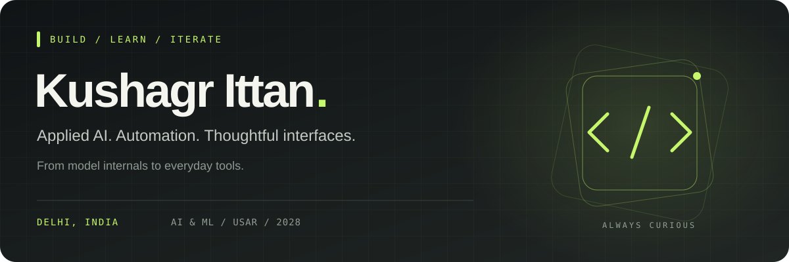

  

  

  
  
  
  

  <b>B.Tech AI &amp; ML · USAR, GGSIPU · Class of 2028</b> 
  Delhi, India · Open to paid remote AI &amp; automation work with flexible hours

---

### A little context

I build AI applications, workflow automations, and interfaces that make them useful. My projects range from a GPT trained from scratch to local document assistants and an outfit decider that knows what's actually clean in your wardrobe.

I completed a **paid AI & automation internship at CSOS Pvt. Ltd.** from **24 June to 24 August 2026**, working on document intelligence and claims workflows. I also bring design experience from **GDG-USAR**, and a soft spot for computer vision, AR, and browser games.

**Currently exploring:** transformer internals, retrieval quality, and reliable automation—with enough attention to the interface that people can actually use what I build.

### Selected builds

<table>
  <tr>
    <td width="50%" valign="top">
      <h3>01 / ShakespeareGPT</h3>
      
<b>A tiny GPT, built from the inside out.</b>

      
Character-level transformer trained from random weights on Shakespeare. Implements causal self-attention, transformer blocks, training, and text generation, with an executed notebook and loss curves.

      
<code>Python</code> <code>PyTorch</code> <code>Transformers</code>

      
<a href="https://github.com/KushagrIttan/ShakespeareGPT">Explore the model →</a>

    </td>
    <td width="50%" valign="top">
      <h3>02 / FitFlow</h3>
      
<b>Your wardrobe, with a little more logic.</b>

      
Outfit decider and wardrobe app that tracks laundry availability and scores outfits against weather, context, and wear history. Optional Gemini styling complements the local recommendation engine.

      
<code>Flutter</code> <code>Dart</code> <code>SQLite</code> <code>Gemini</code>

      
<a href="https://github.com/KushagrIttan/FitFlow">Explore the app →</a>

    </td>
  </tr>
  <tr>
    <td width="50%" valign="top">
      <h3>03 / Salaahkar</h3>
      
<b>Study with your sources close by.</b>

      
Local RAG study assistant for PDFs, OCR text, and lecture transcripts. Combines vector and keyword retrieval, source citations, and Ollama inference in a Streamlit interface.

      
<code>Python</code> <code>LangChain</code> <code>ChromaDB</code> <code>Ollama</code>

      
<a href="https://github.com/KushagrIttan/Salaahkar">Explore the assistant →</a>

    </td>
    <td width="50%" valign="top">
      <h3>04 / NotesheetAI</h3>
      
<b>From a request to a reviewable note-sheet.</b>

      
Administrative drafting prototype grounded in retrieved precedents. Includes rule references, document checklists, approval thresholds, and persistent multi-stage approval workflows.

      
<code>FastAPI</code> <code>Next.js</code> <code>FAISS</code> <code>RAG</code>

      
<a href="https://github.com/KushagrIttan/SC_Automation">Explore the workflow →</a>

    </td>
  </tr>
  <tr>
    <td width="50%" valign="top">
      <h3>05 / LogiKal</h3>
      
<b>Making shipment checks easier to inspect.</b>

      
Logistics compliance prototype with shipment intake, rule checks, LLM-assisted categorization, and experimental hash-linked records. Built for Logithon 2025.

      
<code>Python</code> <code>Streamlit</code> <code>Automation</code>

      
<a href="https://github.com/KushagrIttan/logikal">Explore the project →</a>

    </td>
    <td width="50%" valign="top">
      <h3>06 / Angel Eyes</h3>
      
<b>Exploring interaction through vision and voice.</b>

      
Computer vision prototype with webcam hand and pose tracking, heuristic gesture and movement alerts, and voice-triggered help-event logging.

      
<code>Python</code> <code>OpenCV</code> <code>MediaPipe</code>

      
<a href="https://github.com/KushagrIttan/Angel_Eyes">Explore the prototype →</a>

    </td>
  </tr>
</table>

### More corners of my GitHub

| Project | What I worked on |
| :--- | :--- |
| [SahayBot · सहायबॉट](https://github.com/KushagrIttan/SahayBot) | English/Hindi cooperative guidance prototype with PDF retrieval, page citations, and editable grievance drafts. |
| [Switchboard Claims Pilot](https://github.com/KushagrIttan/switchboard-claims-pilot) | CSOS internship project: claims intake, AI-assisted triage and extraction, review queues, and human approval for outbound actions. |
| [HCV Liver Fibrosis Predictor](https://github.com/KushagrIttan/HCV-Liver-Fibrosis-Predictor) | Academic ML project exploring classification, SHAP explanations, class imbalance, and a Streamlit dashboard. |
| [Plagiarism Checker](https://github.com/KushagrIttan/plag-checker) | Enhancements to an existing Python project using TF-IDF and cosine similarity for text comparison. |
| [Velocity Rally](https://github.com/KushagrIttan/Velocity_Rally) | Three.js browser rally game with authored stages, ghost replays, and server-verified runs. |
| [MathMirage](https://github.com/KushagrIttan/MathMirage) | AR mathematics experience built in Lens Studio for Mathethon 2025. |

### Tools I build with

  
  
  
  
  
  
    
  
  
  
  
  
  

| Area | Technologies |
| :--- | :--- |
| **Languages** | Python · TypeScript / JavaScript · C# · Dart · SQL · C |
| **AI & retrieval** | PyTorch · scikit-learn · LangChain · FAISS · ChromaDB · Ollama · Gemini |
| **Apps & APIs** | FastAPI · React · Next.js · ASP.NET Core · Flutter · Streamlit |
| **Data & development** | PostgreSQL · SQLite · Git · Docker · Jupyter |
| **Vision & creative work** | OpenCV · MediaPipe · Three.js · Lens Studio · Figma |

### Hackathon trail

| Event | Build | Result |
| :--- | :--- | :--- |
| **Logithon 2025 · IIT Bombay** | LogiKal | Finalist |
| **CodeZen 2025 · GTBIT** | Angel Eyes | Top 30 |
| **VesHack 2024 · USAR** | Emitless | Top 30 |

### GitHub in numbers

  
  

  

### Me after fixing one bug and breaking everything else

  

---

  <b>Have an AI workflow, app, or automation problem worth building?</b> 
  <a href="mailto:kushagrpc@gmail.com">Let's talk</a> · <a href="https://www.kushagrittan.dev">See my portfolio</a>  
  Usually building something. Occasionally finding out why it broke.

